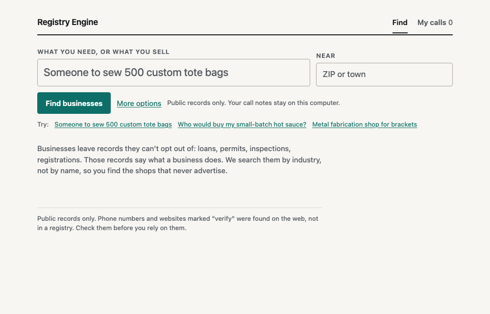
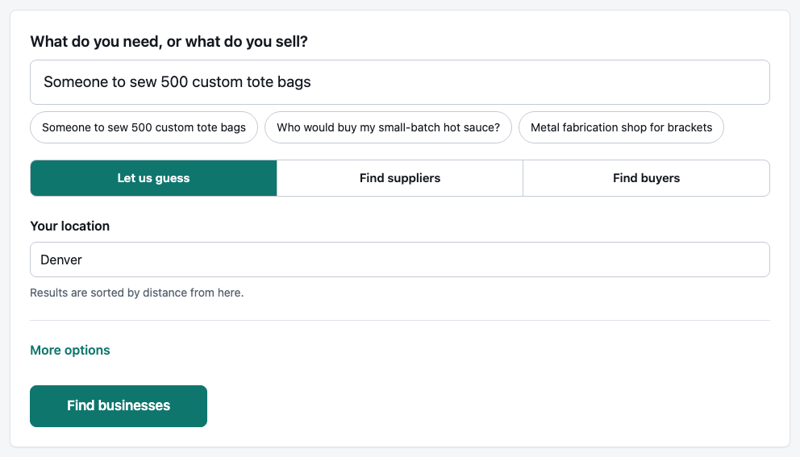
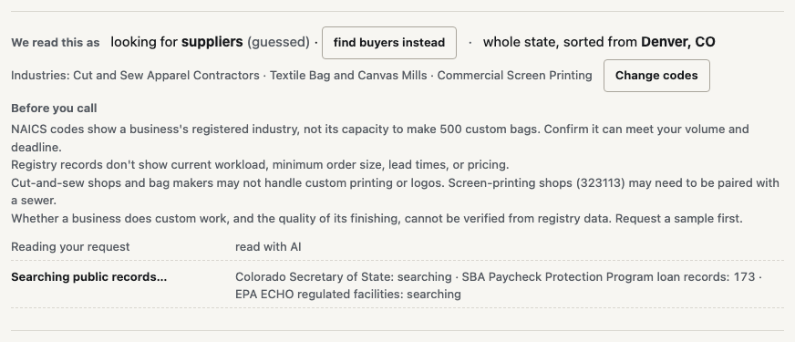
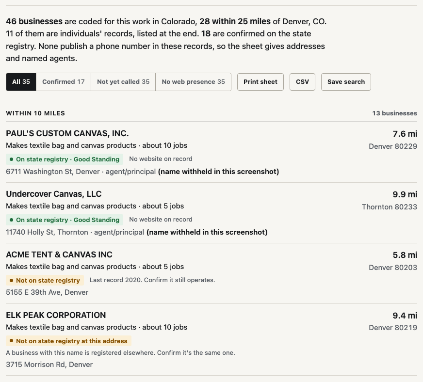
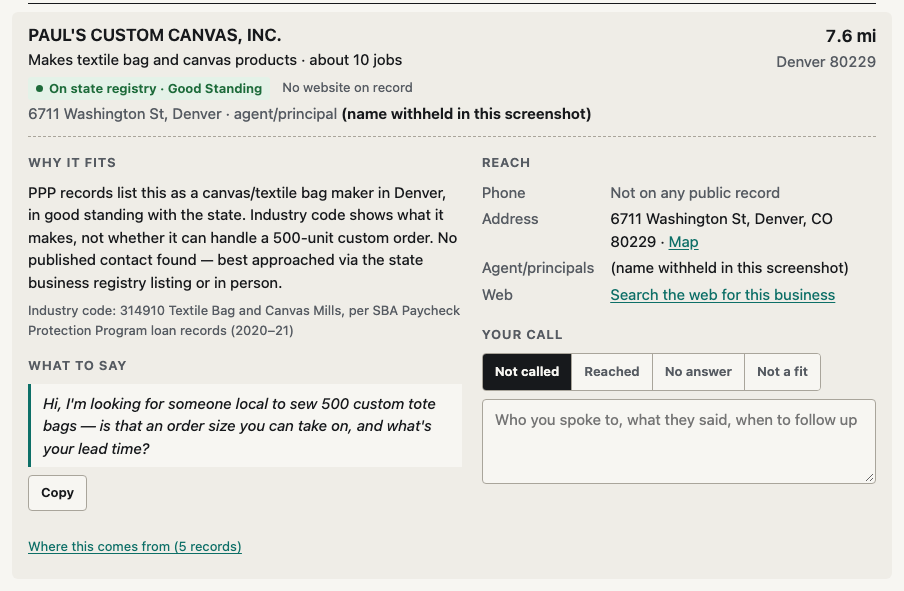
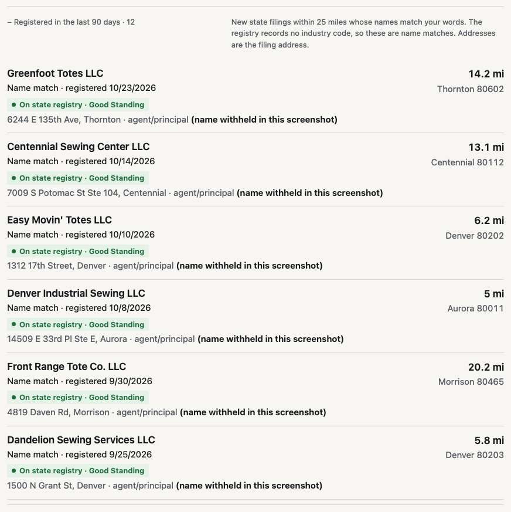

# Registry Engine

Find the local businesses search engines miss: type what you need or what
you sell, and get a call sheet built from public records.
Covers Colorado, Connecticut and New York, plus EPA-regulated facilities
nationwide; another state is mostly a manifest entry ([how](#add-a-state-or-a-source)).



## Run

```bash
npm install
npm start          # → http://localhost:4317
```

**Bring your own keys.** Nothing is required; every key is read from the
shell environment when the app starts ([`.env.example`](.env.example) lists them).

- **AI (optional).** Each search makes 2 AI calls: with `ANTHROPIC_API_KEY`
  set they go to the Anthropic API on your key; otherwise, if
  [Claude Code](https://claude.com/claude-code) is installed and logged in,
  they go through your Claude Code login (`claude -p`). Without either, tick
  **Skip AI**: supplier searches still work, and buyer searches need
  industry codes (the app's **Find codes** helper looks them up).
- **Contacts (optional).** Set `EXA_API_KEY` or `PARALLEL_API_KEY` before
  `npm start`, and the top results get a web lookup for website, phone and email.

**Where your data goes.**

- The server listens on localhost only.
- A search calls the public registries listed under [Sources](#sources).
- The two AI calls go to Anthropic (your API key, or your Claude Code
  login). Anthropic receives the request text and the record facts of the
  top leads (12 by default), with individuals' names withheld.
- Exa or Parallel get one name search per top lead, only if you set a key.
- Cloudflare DNS-over-HTTPS checks the domains a record lists.
- Contact lookups are cached for 30 days in `~/.cache/registry-engine/contacts.json`;
  finished searches are kept in `~/.cache/registry-engine/searches`.
- **My calls** lives in your browser's localStorage.
- Keys are read from the environment, never stored or shown in the page.

Tested on Node 24.

## How a search works

**1. Say what you need, or what you sell,** and where you are. One AI call
turns the request into the industry codes (NAICS) of the businesses to
contact: makers and suppliers if you need something, likely buyers if you
sell something. It guesses the direction and says so; one click flips it.



**2. Public records are searched by industry code, not by name.** Most of
these businesses don't advertise and have no website. The strongest
candidates' names are checked against the state business registry.



**3. You get a field sheet.** One sentence says how many businesses are coded
for the work, how many are near you, how many the state registry confirms
and how many publish a phone. Below it, one ruled row per business, grouped
by distance: what it does in plain words, a trust line, and how to reach it.



The trust line says only what was checked:

- **On state registry** (green): the business joined a registry record.
- **Not on state registry** (amber): its name was looked up and nothing
  matched. Confirm it still operates.
- **Not checked against registry** (grey): it ranked beyond the names
  checked this search.

**4. Open a row** for why it fits, what to say (one copyable sentence in your
own words), every way to reach it, and a place to record the call. A second
AI call writes the notes for the top 12. Your calls collect on the **My
calls** tab across searches.





**Registered in the last 90 days** lists state filings near you whose names
match your request. Individuals' records and name-only matches sit in their
own collapsed groups and never count toward the headline. **About this
search** at the bottom lists every source with its count, how many names
were checked, and the AI tokens used.

Also in the app: saved searches (stored in your browser), CSV export, and a
printable call sheet with a notes line under each business.
Recent searches: the server keeps your 20 newest finished searches in
`~/.cache/registry-engine/searches`, so you can reopen a sheet and its CSV
without running it again.

## Sources

| Source | What it adds | Where | How fresh | Link |
|---|---|---|---|---|
| SBA Paycheck Protection Program loans | Industry code, address and job count for nearly every small business, including sole proprietors | Colorado (153,093 businesses) | 2020–21 snapshot, in `shards/ppp` | [data.sba.gov](https://data.sba.gov/dataset/ppp-foia) |
| EPA ECHO | Regulated facilities: industry code, last inspection | US | Live | [echo.epa.gov](https://echo.epa.gov/) |
| Colorado farm-products financing statements | Growers, their crops and their lenders | Colorado | Live | [data.colorado.gov](https://data.colorado.gov/d/ej2c-jkvh) |
| USDA PACA licenses | Produce dealers, with the phone and email they filed | CO 132 · CT 115 · NY 1,324 | Recorded July 2026, in `shards/paca` | [apps.mrp.usda.gov](https://apps.mrp.usda.gov/public_search) |
| Colorado Secretary of State | Legal name, standing, registered agent, trade names, formation date | Colorado | Live | [entities](https://data.colorado.gov/d/4ykn-tg5h) · [trade names](https://data.colorado.gov/d/u7sb-g482) |
| Connecticut Secretary of the State | Legal name, standing, formation date | Connecticut | Live | [data.ct.gov](https://data.ct.gov/d/n7gp-d28j) |
| New York Department of State | Legal name, registered agent, filing date | New York | Live | [data.ny.gov](https://data.ny.gov/d/n9v6-gdp6) |

Each search uses only the sources that cover its state and industries.
Colorado has all of them; Connecticut and New York have their registry plus
PACA; EPA ECHO covers every state.

Bundled reference data: [NAICS 2017 codes and index](https://www.census.gov/naics/)
(Census) and [ZIP and place centroids](https://www.census.gov/geographies/reference-files/time-series/geo/gazetteer-files.html)
(Census 2024 Gazetteer), used for distances.
Outside services: [Exa](https://exa.ai) or [Parallel](https://parallel.ai) for
the optional contact lookup, and Cloudflare DNS-over-HTTPS to check domains a
record lists.

## Add a state or a source

Sources are entries in
[`packages/registry-core/src/sources/manifest.json`](packages/registry-core/src/sources/manifest.json)
(the `SourceSpec` keys are listed in [`CLAUDE.md`](CLAUDE.md#the-manifest-is-the-extension-point)).

1. **A registry on Socrata, a static shard, or EPA ECHO** is a manifest
   entry, no code. [`zero-code-state.test.ts`](tests/registry-core/zero-code-state.test.ts)
   pins this for the `socrata` driver. An existence registry wants
   `quirks.cities` so a town in the request is detected.
2. **PPP for another state**: run
   `python3 -I scripts/data/build_ppp_shards.py --state XX --out shards/ppp <ppp csvs…>`
   over the public SBA CSVs, and add `US-XX` to the `ppp` entry's
   `quirks.shardRegions`.
3. **Another platform** (CKAN, ArcGIS, bulk CSV) needs a new driver in
   `packages/registry-core/src/drivers/`. This is the one case that is code.

ZIP centroids are national; town names as a search center need the state's
places: `python3 -I scripts/data/build_geo.py --states CO,CT,NY,XX`.

## Token usage

Every search makes at most 2 AI calls, never one per business. Both go
to the Anthropic API (with `ANTHROPIC_API_KEY`) or through `claude -p` with
no tools loaded, so the prompt is only the request and the record facts. **About this search** at the bottom of the results
shows the tokens each search used.

Measured on 2026-10-28 through `claude -p`:

| Search | Map call (Claude Haiku 5.5) | Notes call (Claude Sonnet 5.5) | Total | API-price equivalent |
|---|---|---|---|---|
| Tote bags near Denver (web app) | 4,799 in / 732 out | 6,245 in / 2,344 out | 14,120 | $0.050 |

The run that produced the screenshots above used 12.9k tokens (about $0.05).
About 14k tokens per search. The notes call costs more because it reads the
facts of the top 12 businesses.

The cost column is the API-price equivalent that `claude -p` reports. With
a Claude subscription, searches count against your plan's usage, not a per-token bill.
With `ANTHROPIC_API_KEY` the sheet shows tokens only (the API returns no
price); the bill is on your Anthropic console.
**Skip AI** uses 0 tokens.

## HTTP API and library

The local server is the API. Start it with `npm start`, then:

```bash
curl -N -X POST http://localhost:4317/api/search \
  -H 'Content-Type: application/json' \
  -d '{"query":"who would buy my hot sauce","near":"80302"}'
```

Any other Host header gets 403: the API is local-only by design. One search
runs at a time (a second gets 429), bad fields get 400, and a body that isn't
JSON gets 415. The body fields are `query`, `near`, `radiusMi`, `naics`,
`leads`, `region`, `direction`, `checkAll`, `findContacts` and `noLlm` (see
`parseSearchParams` in `apps/web/src/server.ts`).

The response is newline-delimited JSON, one event per line:

- `map`: the industry codes the request was read as
- `origin`: the resolved search center, if any
- `routed`: the sources that cover the region and codes
- `fetched`: records fetched from one source
- `source_error`: a source that failed (the search continues)
- `merged`: records merged across sources
- `backfilled`: names matched in the state registry
- `backfill_progress`: progress of the registry name check
- `probed`: websites checked
- `recent`: recent filings near the center
- `contacts`: web contact lookups made
- then exactly one of `result` (the call sheet) or `error`

Other routes:

- `GET /api/status` (also `HEAD`): which AI and contact paths are active, and the regions
- `GET /api/codes?q=`: the code finder
- `GET /api/history`: past searches
- `GET /api/history/:id`: one past search
- `GET /api/csv`: the last search as CSV
- `GET /api/csv?id=`: a past search as CSV

The engine is also a library. Inside this repo, run with
`npx vite-node your-script.ts`; the packages aren't published.

```ts
import { search } from "@registry-engine/qualify";

const out = await search("metal fabrication", { region: "US-CO", contacts: null });
console.log(out.ranked.slice(0, 10).map(l => l.entity.name));
```

Leaving out `llm` means the static table (supplier searches only); pass
`llm: { backend: llmBackendFromEnv().backend }` for the at most 2 AI calls
per search. `contacts: null` keeps paid lookups off even when a key is in
the env.

## Know before you call

- An industry code says what a business **is**, not whether it can take your job.
- Buyer leads fit by industry. No public record shows what a business buys.
- PPP is a 2020–21 snapshot. The trust line shows which leads the state registry still lists, and which weren't checked.
- Public records only. Contacts found on the web are labeled "verify", with
  sources. Individuals' records never get a web lookup.
- Without an Exa or Parallel key the sheet says nothing about websites; every
  business lead keeps its search link.
- Each search checks up to 80 names against the state registry. When there
  are more, the sheet says "Checked 80 of N names" and a **Check all N names**
  button re-runs the search with every name checked (about 0.25 s per name).

## Development

```bash
npm test && npm run typecheck
```

Architecture, conventions and the data rebuild scripts: [`CLAUDE.md`](CLAUDE.md).
Threat model: [`SECURITY.md`](SECURITY.md). Decisions: [`docs/decisions/`](docs/decisions/).
README media is captured from the running app with
[`scripts/docs/capture.mjs`](scripts/docs/capture.mjs).

MIT, see [`LICENSE`](LICENSE).
